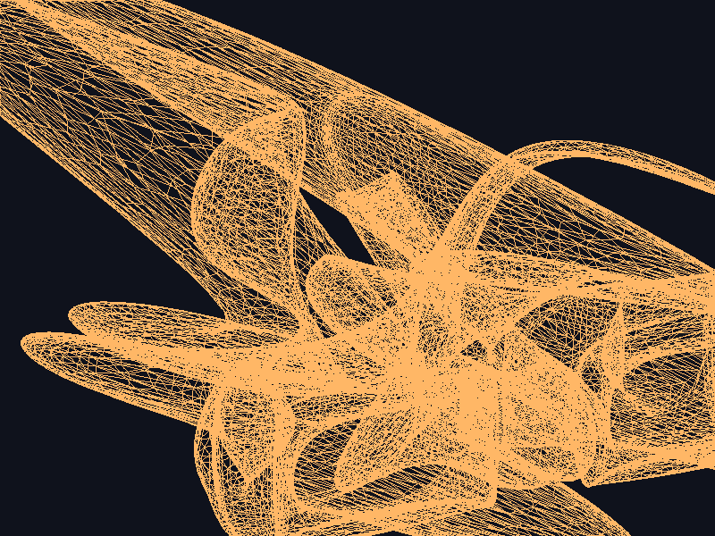
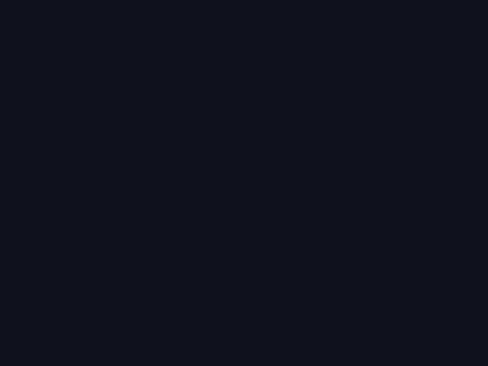
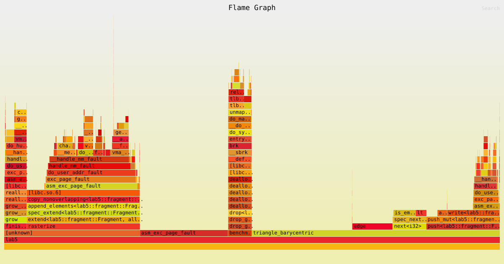
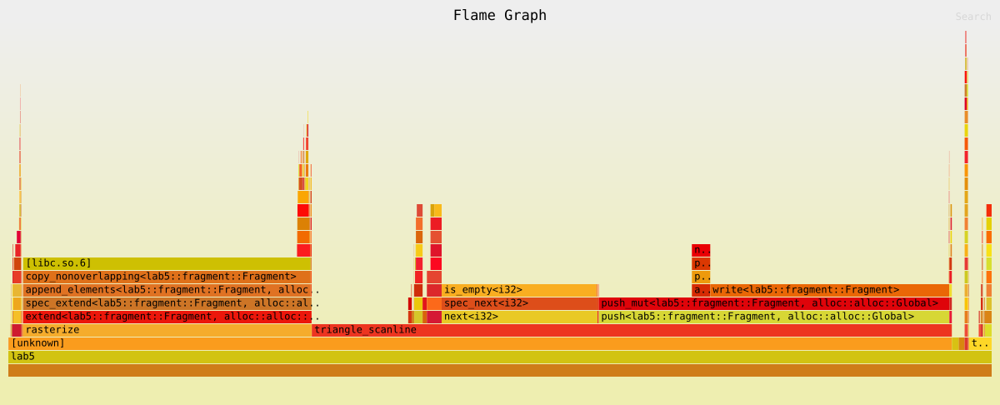

# Lab 5: Rasterización de triángulos

Implementación de un renderer por software desarrollado desde cero en Rust con `raylib`. El proyecto carga modelos Wavefront `.obj`, procesa sus vértices mediante uniforms y shaders, ensambla triángulos y los rasteriza como fragmentos sobre un framebuffer propio.

Este Laboratorio 5 es la continuación del trabajo desarrollado en el Laboratorio 4. El repositorio de la etapa anterior puede consultarse aquí: [Lab 4: lab4-graficas](https://github.com/MarceloDetlefsen/lab4-graficas.git).



## Cómo correr el proyecto

### Requisitos

- **Rust + Cargo** (edición 2024 o versión moderna instalada).
- Herramientas de compilación de C y CMake para `raylib-sys`.

### Build y ejecución

**Abrir el renderer interactivo:**

```bash
cargo run --release
```

**Exportar un modelo individual:**

```bash
cargo run --release -- assets/Nave_X_Y.obj images/salida.png
```

**Exportar los tres modos y la imagen de diferencias:**

```bash
cargo run --release -- --export-modes
```

**Ejecutar el benchmark sin abrir ventana:**

```bash
cargo run --release -- --benchmark-triangles
cargo run --release -- --benchmark-triangles barycentric
cargo run --release -- --benchmark-triangles scanline
```

**Ejecutar las pruebas:**

```bash
cargo test
cargo test -- --nocapture
```

La ventana utiliza un framebuffer fijo de `800x600`. Sus controles son:

- Flechas izquierda/derecha: rotación horizontal.
- Flechas arriba/abajo: rotación vertical.
- Rueda del mouse: zoom.
- `1` y `2`: rotación automática horizontal y vertical.
- `R`: reiniciar cámara, zoom y movimiento automático.
- `W`, `B` y `S`: wireframe, relleno baricéntrico y relleno scanline.

## Descripción

El proyecto implementa un pipeline gráfico completo por software, sin utilizar las funciones 3D automáticas de Raylib:

- **Parser manual OBJ:** carga vértices (`v`) y caras (`f`), convirtiendo índices OBJ base 1 a índices Rust base 0.
- **Uniforms y matriz de modelo:** todos los vértices de un dibujo comparten la misma matriz.
- **Vertex shader:** transforma cada vértice usando una posición homogénea `Vector4`.
- **Primitive assembly:** agrupa vértices consecutivos en triángulos de tres elementos.
- **Rasterización:** genera fragmentos mediante wireframe, coordenadas baricéntricas o scanline.
- **Fragment shader:** devuelve el color del fragmento sin modificarlo.
- **Framebuffer propio:** escribe píxeles en una imagen de `800x600` y la presenta en la ventana o la exporta a PNG.

### Preparación del modelo

El modelo principal es `assets/Nave_X_Y.obj`, exportado como malla triangulada. También se conserva `assets/cube.obj` como modelo pequeño de prueba.

---

## Pipeline de Renderizado

```text
Archivo .OBJ
    ↓
Parser manual (load_obj): vértices e índices
    ↓
Vertex shader: aplicación de uniforms.model_matrix
    ↓
Primitive assembly: grupos de tres vértices
    ↓
Rasterización: wireframe, baricéntrico o scanline
    ↓
Fragment shader: selección del color
    ↓
Framebuffer::set_pixel
    ↓
Ventana o exportación PNG
```

### Regla común de rasterización

El centro del píxel `(x, y)` se evalúa en `(x + 0.5, y + 0.5)`. La regla de borde es inclusiva: los centros sobre aristas y vértices pertenecen al triángulo. Las aristas horizontales incluyen ambos extremos para evitar huecos; el intervalo por fila evita duplicados. Los triángulos degenerados se descartan con `DEGENERATE_EPS = 1e-6` y los bounding boxes se recortan al framebuffer.

Una regla top-left aplicada de forma distinta puede causar duplicados entre triángulos adyacentes si ambos incluyen el borde, o huecos si ambos lo excluyen. En este laboratorio ambos algoritmos comparten la regla inclusiva.

### Modos de rasterización

El modo **baricéntrico** calcula tres funciones de arista para cada centro de píxel del bounding box. El modo **scanline** calcula las intersecciones de cada fila horizontal y rellena entre la izquierda y la derecha. Wireframe conserva el trazado de las aristas con Bresenham.

## Comparativa de resultados

Las imágenes se generan con:

```bash
cargo run --release -- --export-modes
```

La exportación utiliza yaw `0.6`, pitch `0.3`, zoom `1.0` y el color naranja pálido del renderer.

| Modo | Resultado |
| :---: | :---: |
| Wireframe |  |
| Baricéntrico |  |
| Scanline |  |
| Diferencias |  |

`mode_diff.png` es una máscara: pinta de rojo solo los píxeles distintos. Por eso aparece con el fondo cuando la salida imprime `Sin diferencias`; no es una imagen adicional del modelo.

## Pruebas de equivalencia

Las pruebas cubren triángulos pequeños y grandes, aristas horizontales y verticales, coordenadas enteras y `.5`, triángulos parcialmente o completamente fuera del framebuffer, degenerados, un conteo conocido y 2000 triángulos pseudoaleatorios generados con un LCG determinista.

Resultado real:

```text
4 tests passed
Diferencias de borde: 20 de 20
```

Las 20 diferencias encontradas por la prueba aleatoria estuvieron a menos de `1e-3` de una arista.

## Benchmark

El benchmark mide únicamente la generación de fragmentos en `rasterize`. Excluye `set_pixel`, texturas, ventana y esperas. Usa una ejecución de calentamiento, 11 mediciones, 20 iteraciones para la nave y 2000 para el conjunto de triángulos grandes.

CPU registrada: **11th Gen Intel(R) Core(TM) i7-11800H @ 2.30GHz**. El binario indicó `Release: true`.

| Conjunto | Modo | Fragmentos | Mediana por ejecución | Mín | Máx |
|---|---|---:|---:|---:|---:|
| nave | Wireframe | 1,262,853 | 19,278,434 ns | 17,652,347 ns | 20,413,022 ns |
| nave | FilledBarycentric | 1,016,767 | 32,972,877 ns | 31,917,810 ns | 34,521,004 ns |
| nave | FilledScanline | 1,016,779 | 19,540,252 ns | 18,312,406 ns | 19,868,330 ns |
| grandes | Wireframe | 10,534 | 76,127 ns | 75,016 ns | 79,658 ns |

La corrida completa del conjunto `grandes` no terminó en este entorno con las 2000 iteraciones solicitadas; por honestidad no se agregan filas no medidas.

En general, baricéntrico paga un costo por cada píxel del bounding box, mientras scanline concentra parte del trabajo en cada fila. Los triángulos delgados o diagonales pueden tener bounding boxes grandes respecto al área cubierta. Ambos algoritmos generan `Fragment` y hacen crecer el `Vec`, lo cual también forma parte del costo observado.

## Flamegraph

Los flamegraphs fueron generados en Arch Linux con `perf` y el binario release con símbolos de depuración:

```bash
cargo install flamegraph
sudo pacman -S perf
sudo sysctl kernel.perf_event_paranoid=1
cargo flamegraph -o images/flamegraph_barycentric.svg -- --benchmark-triangles barycentric
cargo flamegraph -o images/flamegraph_scanline.svg -- --benchmark-triangles scanline
```

Si `perf` ya tiene permisos suficientes, no hace falta utilizar `sudo`.





En el flamegraph baricéntrico, `triangle_barycentric` representa aproximadamente el **50.04%** de las muestras. También aparecen `rasterize` con **22.81%**, `append_elements<Fragment>` con **22.76%**, `push<Fragment>` con **14.71%** y `write<Fragment>` con **10.52%**. Esto muestra que el cálculo geométrico por píxel es importante, pero también lo son la creación y copia de fragmentos.

En scanline, el SVG muestra `push<Fragment>` con **35.66%**, `append_elements<Fragment>` con **29.24%** y `realloc_nonnull` con **0.80%**. El perfil confirma que el crecimiento y almacenamiento del `Vec<Fragment>` ocupan una parte importante del tiempo observado. También se identifica `grow_one<Fragment>`, aunque con porcentajes menores.

La lectura debe hacerse con cuidado: los porcentajes del flamegraph son muestras de los stacks y algunas funciones aparecen en varias ramas. Aun así, ambos perfiles respaldan la comparación conceptual: baricéntrico paga trabajo geométrico por píxel del bounding box, mientras scanline reduce parte del cálculo a intersecciones por fila, pero ambos terminan generando y almacenando muchos `Fragment`.

## Estructura del proyecto

```text
.
├── .gitignore          # Archivos y directorios ignorados por Git
├── README.md           # Documentación del proyecto, pipeline y comparativas
├── Cargo.toml          # Configuración del crate, perfiles y dependencias
├── Cargo.lock          # Versiones bloqueadas de dependencias
├── assets/
│   ├── Nave_X_Y.obj    # Modelo principal de la nave
│   └── cube.obj        # Modelo 3D básico de prueba
├── images/
│   ├── mode_wireframe.png         # Render wireframe
│   ├── mode_barycentric.png       # Relleno baricéntrico
│   ├── mode_scanline.png          # Relleno scanline
│   ├── mode_diff.png              # Diferencias entre rellenos
│   ├── flamegraph_barycentric.svg # Perfil del algoritmo baricéntrico
│   └── flamegraph_scanline.svg    # Perfil del algoritmo scanline
└── src/
    ├── main.rs         # Punto de entrada, ventana y pipeline
    ├── framebuffer.rs  # Búfer de píxeles, set_pixel y exportación
    ├── fragment.rs     # Estructura Fragment
    ├── vertex.rs       # Estructura Vertex
    ├── shaders.rs      # Vertex shader y fragment shader
    ├── primitive.rs    # Ensamblaje de triángulos
    ├── rasterizer.rs   # Modos y despacho de rasterización
    ├── triangle.rs     # Wireframe, baricéntrico y scanline
    ├── scene.rs        # Matrices y construcción de triángulos
    ├── benchmark.rs    # Benchmark sin ventana
    ├── triangle_tests.rs # Pruebas de equivalencia
    ├── obj.rs          # Parser manual de OBJ
    ├── render.rs       # Pipeline anterior de exportación
    └── line.rs         # Algoritmo de líneas de Bresenham
```

## Limitaciones actuales

- No hay z-buffer ni eliminación de caras ocultas.
- La proyección es ortográfica; todavía no hay perspectiva ni división por `w`.
- El color y la profundidad de los fragmentos rellenos son uniformes en esta etapa.
- El análisis detallado del flamegraph queda pendiente hasta inspeccionar los SVG generados con `perf`.

## Dependencias principales

- [`raylib`](https://crates.io/crates/raylib) — Tipos geométricos, `Image`, ventana y carga de texturas para presentar el framebuffer. No se usa para cargar ni dibujar modelos 3D.

## Autor

**Marcelo Detlefsen** - Carné 24554  
*Universidad del Valle de Guatemala*  
*Gráficas por Computadora - Laboratorio 5*
